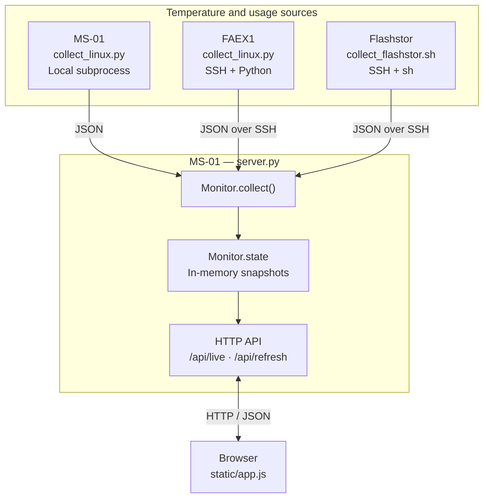

# Homelab Monitor

**Version:** v1.1.0 — live Temperature and Usage monitoring.

## Reporting

### Temperature tab

Shows currently available temperature sensors per machine. FAEX1 and MS-01 list individual NVMe drives; Flashstor lists its 12 NVMe drives under **CRUCIAL P3 PLUS 4 TB ARRAY**. Temperature drive labels retain their device/OS descriptions (for example, `Samsung 990 PRO 2 TB — Ubuntu`).

Colors are advisory thresholds, not manufacturer-defined thermal limits.

| Component | Normal | Warning | Critical |
|-----------|--------|---------|----------|
| CPU | Below 80°C | 80–94.9°C | 95°C and above |
| GPU | Below 75°C | 75–84.9°C | 85°C and above |
| SSD | Below 60°C | 60–69.9°C | 70°C and above |

These thresholds are defined in `static/app.js`.

### Usage tab

Shows **CPU** and **GPU** aggregate utilization, **RAM** usage, and filesystem capacity. Percentages and progress bars use green/amber/red utilization thresholds; RAM and storage used/total capacity labels remain neutral.

| Metric | Normal | Warning | Critical |
|--------|--------|---------|----------|
| CPU / GPU | Below 70% | 70–89.9% | 90% and above |
| RAM | Below 75% | 75–89.9% | 90% and above |
| Storage | Below 80% | 80–94.9% | 95% and above |

The usage thresholds are display guidance, **not** hardware failure or thermal limits. Usage capacities are displayed in decimal **GB/TB (base 1000)**, not GiB/TiB. CPU/GPU are utilization percentages, not temperature or power consumption.

| Host | Usage storage shown | What is counted |
|------|---------------------|-----------------|
| FAEX1 | `Samsung 990 PRO 2 TB — ext4`; `Intel Optane P5800X 1.6 TB — XFS` | Mounted Ubuntu root and `/mnt/p5800x` filesystems |
| MS-01 | `Samsung PM9A3 15.36 TB — Btrfs` | Mounted Ubuntu root filesystem |
| Flashstor | `RAID5 — Btrfs` | The `/volume1` filesystem as **one** RAID volume, not 12 individual capacity readings |

The Windows SSD on FAEX1 can still appear in the **Temperature** tab because its physical sensor is readable, but its **Usage** card and volume count are omitted while the filesystem is unmounted. Filesystem mount paths are not shown on the cards. Reported storage capacity is filesystem usage, not an SSD's advertised raw capacity.

### Offline behavior

If collection fails:

- The affected host is marked offline, with an error message.
- Previously collected temperature and usage values are **not presented as live**; unavailable usage values appear as `N/A`.
- The server retains the last successful snapshot in memory for diagnostics, but the UI does not treat it as a fresh reading.

When the monitoring server itself becomes unreachable, the frontend reports the connection failure and continues retrying.

## Validation

```bash
cd services/homelab-monitor
python3 -m unittest discover -s tests -v
python3 -m py_compile server.py collect_linux.py
sh -n collect_flashstor.sh
if command -v node >/dev/null; then node --check static/app.js; fi
```

### Deployment verification

```bash
ansible-playbook setup_homelab_monitor.yml --check --diff
```

Verify HTTP availability:

```bash
curl -fsS http://192.168.50.100:8765/
```

Verify the live API:

```bash
curl -fsS http://192.168.50.100:8765/api/live
```

### Deployment

```bash
ansible-playbook setup_homelab_monitor.yml
```

## Troubleshooting

### Service unavailable

Check the systemd service on MS-01:

```bash
systemctl status homelab-temp-monitor.service
journalctl -u homelab-temp-monitor.service -n 100 --no-pager
```

Check the listening port:

```bash
sudo ss -ltnp | grep 8765
```

### Host offline

SSH must work noninteractively from the `rex` account on MS-01.

Verify the remote collectors from `/home/rex/homelab/homelab-monitor` on MS-01:

```bash
python3 collect_linux.py --profile ms01 | python3 -m json.tool

ssh -T -o BatchMode=yes faex1 \
  'python3 - --profile faex1' \
  < collect_linux.py | python3 -m json.tool

ssh -T -o BatchMode=yes flashstor \
  'sh -s' \
  < collect_flashstor.sh | python3 -m json.tool
```

### Missing temperatures

Check hardware sensor availability on the affected machine:

```bash
ls /sys/class/hwmon/hwmon*/name
```

For NVIDIA GPU temperatures on MS-01:

```bash
nvidia-smi --query-gpu=temperature.gpu \
  --format=csv,noheader,nounits
```

Missing temperatures may indicate unavailable sensors, driver limitations, or changes to the Linux sysfs topology.

### Missing or incorrect usage readings

Check the complete collector JSON using the commands in **Host offline** above; the `usage` object should contain `cpu_pct`, `gpu_pct`, `ram`, and `storage`. A `null` value means the reading was unavailable, not necessarily 0%.

On the relevant Linux host, compare against the operating system:

```bash
cat /proc/meminfo | grep -E '^(MemTotal|MemAvailable):'
cat /proc/stat | head -n 1
findmnt -T /  # Inspect the root filesystem
df -h /      # Compare filesystem used/total
```

For FAEX1, verify `/mnt/p5800x` is actually mounted before interpreting its capacity. For MS-01, check `nvidia-smi --query-gpu=utilization.gpu --format=csv,noheader,nounits`; for FAEX1, inspect `/sys/class/drm/card*/device/gpu_busy_percent` (where supported). Flashstor storage is measured at `/volume1` with `df`; usage shown for an unavailable mount must not be interpreted as another filesystem's capacity.

## How it works

### Architecture

MS-01 is both the central collector and the HTTP server. It runs `server.py` through the `homelab-temp-monitor.service` systemd service, listening on `192.168.50.100:8765`. All monitoring collection is initiated by MS-01; FAEX1 and Flashstor do not run persistent monitoring agents.



The website is completely independent of the interactive `temps` utilities installed by `setup_temps.yml`. Those scripts read similar underlying hardware sensors but are neither executed nor parsed by the web monitor. The website uses its own collectors, maintained in `services/homelab-monitor/` and deployed only to MS-01 through `setup_homelab_monitor.yml`.

### Systemd service — `homelab-temp-monitor.service`

`setup_homelab_monitor.yml` installs a system-level systemd unit at `/etc/systemd/system/homelab-temp-monitor.service` on MS-01 and enables it to start automatically at boot.

The service uses the following configuration:

| Setting | Value |
|---------|-------|
| User / Group | `rex` / `rex` |
| Working directory | `/home/rex/homelab/homelab-monitor` |
| Python executable | `/usr/bin/python3` |
| Script | `/home/rex/homelab/homelab-monitor/server.py` |
| Bind address | `192.168.50.100` |
| Port | `8765` |
| Startup dependency | `network-online.target` |
| Restart policy | `on-failure`, after 3 seconds |
| Boot target | `multi-user.target` |

Systemd starts `server.py` with `--bind 192.168.50.100 --port 8765`. The Python process runs continuously, handling HTTP requests and collecting temperature and utilization readings in a background thread.

Ansible manages the application files and systemd unit. When deployed files or configuration change, Ansible restarts the service to apply the changes. Repeated deployments without changes do not restart it.

Service output and collector errors are available through `journalctl`. No separate systemd services are installed on FAEX1 or Flashstor.

### Collection scheduling — `server.py`

At startup, `main()` reads `config.json`, creates a `Monitor` instance, starts a daemon thread running `Monitor.loop()`, and initializes Python's `ThreadingHTTPServer`.

`Monitor.loop()` uses a `ThreadPoolExecutor` with one worker per configured host. Each polling cycle submits three `sample_one()` tasks concurrently, rather than sequentially. Each task calls `collect()`, which launches the appropriate collector through `subprocess.run()` with an 8-second timeout.

The configured collection interval is 5 seconds. The interval is measured from the beginning of each cycle, so the loop waits for the remaining interval after all collectors finish. If a cycle takes longer than 5 seconds, the next cycle starts immediately after the current one completes. Collection cycles never intentionally overlap.

### Hardware collection — `collect_linux.py` and `collect_flashstor.sh`

For temperature readings, both collectors read Linux sysfs. Most hardware temperatures are exposed as integer **millidegrees Celsius**, so the raw value must be divided by 1000 (e.g., `42500` = `42.5°C`). The collectors also return aggregate CPU/GPU utilization, RAM usage, and mounted filesystem usage.

Sensor discovery is dynamic because `hwmonX` and `nvmeX` numbering can change across boots. The collectors identify devices using driver names, sensor labels, resolved sysfs paths, PCI addresses, and, where appropriate, NVMe serial numbers.

#### Usage data collection

- **CPU utilization:** the collectors take two samples of the aggregate `cpu` line in `/proc/stat` and compute the busy fraction from counter differences. The Linux Python collector samples over about 0.5 seconds; Flashstor's shell collector samples over about 1 second. `iowait` is treated as idle for this indicator.
- **GPU utilization:** FAEX1 reads AMD `gpu_busy_percent` from `/sys/class/drm/card*/device/`; MS-01 uses `nvidia-smi --query-gpu=utilization.gpu`. Flashstor has no separate GPU utilization card. Unavailable readings are `null`.
- **RAM:** both collectors use `/proc/meminfo`. Used RAM = `MemTotal - MemAvailable`; this avoids counting reclaimable cache as permanently used memory.
- **Filesystems:** Linux uses `os.statvfs()` on mounted paths (`/` and, on FAEX1, `/mnt/p5800x`). Flashstor uses `df -P -k /volume1`. Unmounted or unreadable filesystems are not given fabricated capacity values.
- **Storage labels:** the Usage tab uses filesystem-type labels (ext4, XFS, Btrfs), while the Temperature tab retains its existing device/OS labels.

Each usage reading includes its percentage; RAM and storage also include `used_bytes` and `total_bytes`. The frontend converts byte values into decimal GB/TB.

#### MS-01 — `collect_linux.py --profile ms01`

**CPU — Intel Core i9-13900H**

`collect_linux.py` reads CPU temperatures directly from the `coretemp` hwmon driver under `/sys/class/hwmon/`. Each `tempN_input` contains a raw temperature in **millidegrees Celsius**, while the corresponding `tempN_label` identifies the sensor.

For example, assuming `hwmon2/temp2` corresponds to Core 0:

```bash
cat /sys/class/hwmon/hwmon2/temp2_label
# Core 0

cat /sys/class/hwmon/hwmon2/temp2_input
# 40000 (40.0°C)
```

The raw value `40000` represents **40.0°C** (`40000 / 1000`). Since `hwmonX` and `tempN` numbering can change between boots, the collector discovers sensors dynamically rather than hardcoding their paths.

To list all CPU Package and Core temperatures:

```bash
for hw in /sys/class/hwmon/hwmon*; do
    [ "$(cat "$hw/name" 2>/dev/null)" = coretemp ] || continue

    for label in "$hw"/temp*_label; do
        [ -f "$label" ] || continue

        case "$(cat "$label")" in
            'Package id 0'|'Core '[0-9]*)
                printf '%s: ' "$(cat "$label")"
                awk '{printf "%.1f°C\n", $1/1000}' "${label%_label}_input"
                ;;
        esac
    done
done
# Core 8: 43.0°C
# Core 12: 41.0°C
# Core 16: 44.0°C
# Package id 0: 47.0°C
# Core 20: 40.0°C
# Core 24: 44.0°C
# Core 25: 44.0°C
# Core 26: 44.0°C
# Core 27: 44.0°C
# Core 0: 43.0°C
# Core 28: 44.0°C
# Core 29: 44.0°C
# Core 30: 44.0°C
# Core 31: 44.0°C
# Core 4: 41.0°C
```

The collector uses `Package id 0` as the primary CPU temperature and calculates the hottest core from all available `Core N` readings. The web dashboard currently displays only the **Package temperature**.

**GPU — NVIDIA RTX 2000E Ada**

Unlike CPU and NVMe temperatures, the NVIDIA GPU temperature is obtained through `nvidia-smi` rather than reading sysfs directly. The collector's `nvidia_gpu_temp()` function invokes NVIDIA's management utility using `subprocess.run()`.

Equivalent local command:

```bash
nvidia-smi \
    --query-gpu=temperature.gpu \
    --format=csv,noheader,nounits
# 41
```

The returned value is already in degrees Celsius; no conversion is needed.

**SSD — Samsung PM9A3 15.36 TB**

`collect_linux.py` reads NVMe SMART Composite temperatures directly from the `nvme` hwmon driver under `/sys/class/hwmon/`. Each `tempN_input` contains a raw temperature in **millidegrees Celsius**, while the corresponding `tempN_label` identifies the sensor.

For example, on MS-01:

```bash
cat /sys/class/hwmon/hwmon1/temp2_label
# Sensor 1

cat /sys/class/hwmon/hwmon1/temp2_input
# 40850 (40.85°C)
```

`Sensor 1` is a separate internal SSD temperature sensor. The dashboard uses only **Composite (`temp1_input`)**, not Sensor 1.

To list all NVMe controllers and their Composite temperatures:

```bash
for ctl in /sys/class/nvme/nvme[0-9]*; do
    [ -r "$ctl/model" ] || continue

    controller=$(readlink -f "$ctl")
    pci_path=$(readlink -f "$ctl/device")
    bdf=${pci_path##*/}

    printf '%s | %s\n' "${ctl##*/}" "$(cat "$ctl/model")"

    for hw in /sys/class/hwmon/hwmon*; do
        [ "$(cat "$hw/name" 2>/dev/null)" = nvme ] || continue

        hw_path=$(readlink -f "$hw")

        case "$hw_path" in
            "$controller"/*|*/"$bdf"/*)
                if [ -r "$hw/temp1_input" ]; then
                    awk '{printf "  Composite: %.1f°C\n", $1/1000}' \
                        "$hw/temp1_input"
                fi
                break
                ;;
        esac
    done
done
# nvme0 | SAMSUNG MZQL215THBLA-00AAZ
#   Composite: 40.9°C
```

The collector identifies the PM9A3 by its model string and displays it as **Samsung PM9A3 15.36 TB — Ubuntu**.

#### FAEX1 — `collect_linux.py --profile faex1`

**CPU — AMD Ryzen AI Max+ 395**

`collect_linux.py` reads CPU temperatures directly from the `k10temp` hwmon driver under `/sys/class/hwmon/`. Each `tempN_input` contains a raw temperature in **millidegrees Celsius**, while the corresponding `tempN_label` identifies the sensor.

For example, on FAEX1:

```bash
cat /sys/class/hwmon/hwmon5/temp1_label
# Tctl

cat /sys/class/hwmon/hwmon5/temp1_input
# 36125 (36.125°C)
```

The raw value `36125` represents **36.125°C** (`36125 / 1000`), rounded to **36.1°C** by the collector. Since `hwmonX` and `tempN` numbering can change between boots, the collector discovers the `k10temp` device and its `Tctl` sensor dynamically.

To read Tctl without hardcoding the hwmon path:

```bash
for hw in /sys/class/hwmon/hwmon*; do
    [ "$(cat "$hw/name" 2>/dev/null)" = k10temp ] || continue

    for label in "$hw"/temp*_label; do
        [ -f "$label" ] || continue
        [ "$(cat "$label")" = Tctl ] || continue

        awk '{printf "Tctl: %.1f°C\n", $1/1000}' \
            "${label%_label}_input"
    done
done
# Tctl: 35.9°C
```

The collector's `named_sensor()` function retrieves `Tctl` as the primary CPU temperature. It also collects SoC temperature separately from AMD GPU Metrics v3.0, but the web dashboard currently displays only **Tctl**.

**GPU — AMD Radeon 8060S**

`collect_linux.py` reads the GPU Edge temperature directly from the `amdgpu` hwmon driver under `/sys/class/hwmon/`.

For example, on FAEX1:

```bash
cat /sys/class/hwmon/hwmon7/temp1_label
# edge

cat /sys/class/hwmon/hwmon7/temp1_input
# 34000 (34.0°C)
```

To locate the GPU Edge sensor dynamically:

```bash
for hw in /sys/class/hwmon/hwmon*; do
    [ "$(cat "$hw/name" 2>/dev/null)" = amdgpu ] || continue

    for label in "$hw"/temp*_label; do
        [ -f "$label" ] || continue
        [ "$(cat "$label")" = edge ] || continue

        awk '{printf "GPU Edge: %.1f°C\n", $1/1000}' \
            "${label%_label}_input"
    done
done
# GPU Edge: 35.0°C
```

If the hwmon Edge sensor is unavailable, the collector falls back to AMD GPU Metrics v3.0 (`/sys/class/drm/card*/device/gpu_metrics`). This binary interface also provides SoC temperature, which is collected but not displayed on the dashboard.

**SSDs — Samsung 990 PRO × 2 and Intel Optane P5800X**

`collect_linux.py` reads NVMe SMART Composite temperatures from the `nvme` hwmon driver under `/sys/class/hwmon/`. Each `tempN_input` contains a raw temperature in **millidegrees Celsius**, while the corresponding `tempN_label` identifies the sensor.

For example, assuming `nvme0` and `hwmon4` refer to the same SSD:

```bash
cat /sys/class/nvme/nvme0/model
# Samsung SSD 990 PRO 2TB

cat /sys/class/nvme/nvme0/serial
# S73WNU0XA42780L

cat /sys/class/hwmon/hwmon4/temp2_label
# Sensor 1

cat /sys/class/hwmon/hwmon4/temp2_input
# 33850 (33.85°C)
```

The controller's `model` and `serial` identify the SSD, while the corresponding hwmon directory exposes its temperature sensors. In this example, `temp2_input` represents **Sensor 1** (33.85°C), but the dashboard reads only **Composite (`temp1_input`)**.

Since `nvmeX` and `hwmonX` numbering can change between boots, the collector matches each controller to its hwmon device using resolved sysfs paths, falling back to PCI address matching.

To list all NVMe controllers, their model and serial numbers, and their Composite temperatures:

```bash
for ctl in /sys/class/nvme/nvme[0-9]*; do
    [ -r "$ctl/model" ] || continue

    model=$(cat "$ctl/model")
    serial=$(cat "$ctl/serial")
    controller=$(readlink -f "$ctl")
    pci_path=$(readlink -f "$ctl/device")
    bdf=${pci_path##*/}

    printf '%s | %s | %s\n' \
        "${ctl##*/}" "$model" "$serial"

    for hw in /sys/class/hwmon/hwmon*; do
        [ "$(cat "$hw/name" 2>/dev/null)" = nvme ] || continue

        hw_path=$(readlink -f "$hw")

        case "$hw_path" in
            "$controller"/*|*/"$bdf"/*)
                if [ -r "$hw/temp1_input" ]; then
                    awk '{printf "  Composite: %.1f°C\n", $1/1000}' \
                        "$hw/temp1_input"
                fi
                break
                ;;
        esac
    done
done
```

The collector reads each controller's serial number and uses `FAEX1_LABELS` to assign stable display names.

#### Flashstor 12 Pro — `collect_flashstor.sh`

Flashstor uses its own POSIX shell collector instead of Python. It reads sysfs directly and passes tab-separated intermediate readings to `awk`, which converts temperatures, sorts SSDs, and produces the final JSON object.


**CPU — Intel Celeron N5105**

`collect_flashstor.sh` reads CPU temperatures directly from the `coretemp` hwmon driver under `/sys/class/hwmon/`. Each `tempN_input` contains a raw temperature in **millidegrees Celsius**, while the corresponding `tempN_label` identifies the sensor.

For example, on Flashstor:

```sh
cat /sys/class/hwmon/hwmon1/temp1_label
# Package id 0

cat /sys/class/hwmon/hwmon1/temp1_input
# 49000 (49.0°C)
```

The raw value `49000` represents **49.0°C** (`49000 / 1000`). Since `hwmonX` and `tempN` numbering can change between boots, the collector discovers sensors dynamically rather than hardcoding their paths.

To list all CPU Package and Core temperatures:

```sh
for hw in /sys/class/hwmon/hwmon*; do
    [ "$(cat "$hw/name" 2>/dev/null)" = coretemp ] || continue

    for label in "$hw"/temp*_label; do
        [ -f "$label" ] || continue

        case "$(cat "$label")" in
            'Package id 0'|'Core '[0-9]*)
                printf '%s: ' "$(cat "$label")"
                awk '{printf "%.1f°C\n", $1/1000}' \
                    "${label%_label}_input"
                ;;
        esac
    done
done
```

The collector uses `Package id 0` as the primary CPU temperature and calculates the hottest core from all available `Core N` readings. The web dashboard currently displays only the **Package temperature**.

**SSDs — 12 × Crucial P3 Plus 4 TB**

`collect_flashstor.sh` reads NVMe SMART Composite temperatures from the `nvme` hwmon driver under `/sys/class/hwmon/`. Each `tempN_input` contains a raw temperature in **millidegrees Celsius**, while the corresponding `tempN_label` identifies the sensor.

For example, assuming `nvme0` and `hwmon2` refer to the same SSD:

```sh
cat /sys/class/nvme/nvme0/model
# CT4000P3PSSD8

cat /sys/class/hwmon/hwmon2/temp2_label
# Sensor 1

cat /sys/class/hwmon/hwmon2/temp2_input
# 34850 (34.85°C)
```

The model identifies the SSD type, while its PCI address distinguishes it from the other drives. The corresponding hwmon directory exposes its temperature sensors. In this example, `temp2_input` represents **Sensor 1** (34.85°C), but the dashboard reads only **Composite (`temp1_input`)**.

Since `nvmeX` and `hwmonX` numbering can change between boots, the collector matches each controller to its hwmon device using resolved sysfs paths, falling back to PCI address matching.

To list all NVMe controllers, their models, PCI addresses, and Composite temperatures:

```sh
for ctl in /sys/class/nvme/nvme[0-9]*; do
    [ -r "$ctl/model" ] || continue

    model=$(cat "$ctl/model")
    controller=$(readlink -f "$ctl")
    pci_path=$(readlink -f "$ctl/device")
    bdf=${pci_path##*/}

    printf '%s | %s | PCI %s\n' \
        "${ctl##*/}" "$model" "${bdf#*:}"

    for hw in /sys/class/hwmon/hwmon*; do
        [ "$(cat "$hw/name" 2>/dev/null)" = nvme ] || continue

        hw_path=$(readlink -f "$hw")

        case "$hw_path" in
            "$controller"/*|*/"$bdf"/*)
                if [ -r "$hw/temp1_input" ]; then
                    awk '{printf "  Composite: %.1f°C\n", $1/1000}' \
                        "$hw/temp1_input"
                fi
                break
                ;;
        esac
    done
done
```

Unlike FAEX1, `collect_flashstor.sh` does not use serial numbers to identify SSDs. Instead, `ssd_readings()` extracts each controller's PCI address using `pci_from_path()`, matches its hwmon device, and reads `temp1_input`. The `awk` stage validates the raw temperatures, converts them to Celsius, and sorts the 12 SSDs by PCI address.

The resulting PCI identifiers distinguish the SSDs but **do not correspond to ADM physical bay numbers**.

#### Collector output

All three machines produce the same JSON structure containing:

- `name` and `observed_at`
- `cpu` with labeled readings
- `gpu` with labeled readings, or `null`
- `ssds` with identifiers, names, device paths, PCI addresses, and Composite temperatures
- `expected_ssds`
- `usage`:
  - `cpu_pct` and `gpu_pct` — aggregate utilization, or `null`.
  - `ram` — `used_bytes`, `total_bytes`, and `pct`.
  - `storage` — filesystem entries with `name`, `mount`, `used_bytes`, `total_bytes`, and `pct`.

The collectors return `null` for unavailable temperature or usage measurements rather than inventing values. Temperature collection never falls back to NVMe Sensor 1/2.

For an end-to-end check of the collector itself, run the appropriate script directly. On MS-01, the collectors can also be tested remotely using the SSH commands documented under Troubleshooting.

**Important:** These diagnostic examples are not part of the web monitor's execution path. The application obtains its readings directly through the Python and shell collectors, not through the interactive `temps` scripts or by invoking the example commands above.

### SSH execution

The SSH targets (`faex1` and `flashstor`) are specified in `config.json` and resolved through the `rex` account's SSH configuration on MS-01, independently of the Ansible inventory.

SSH is invoked with:

- `BatchMode=yes` — fail rather than prompt for credentials.
- `ConnectTimeout=3` — 3-second connection timeout.
- `ServerAliveInterval=2` and `ServerAliveCountMax=1` — detect unresponsive connections.
- `-T` — disable pseudo-terminal allocation.

Standard input carries the collector source. Standard output carries one JSON object. Standard error carries diagnostic messages. `collect()` checks the subprocess exit status, parses stdout with `json.loads()`, validates the expected top-level fields, and rejects oversized output.

SSH multiplexing is configured in `/home/rex/.ssh/config` on MS-01:

```sshconfig
# Homelab Monitor SSH multiplexing
Host faex1 flashstor
    ControlMaster auto
    ControlPersist 120s
    ControlPath ~/.ssh/cm-%C
```

OpenSSH reuses existing connections and keeps idle master connections available for 120 seconds. Remote collectors exit after returning their JSON, but SSH master connections can remain open between collection cycles.

This SSH configuration is maintained separately from `setup_homelab_monitor.yml`.

### State management and failure handling

Each `sample_one()` updates its entry in `Monitor.state` under a `threading.Lock`. The state contains:

- `data` — most recent successful collector JSON.
- `last_ok_at` — timestamp of the last successful collection.
- `last_attempt_at` — timestamp of the latest collection attempt.
- `last_error` — most recent collection error.
- `is_healthy` — whether the latest attempt succeeded.

Successful collections replace the previous data and clear the error. Failed collections retain the previous successful data but set `is_healthy` to `False` and record the exception. Errors are logged through Python's logging system and are available in the systemd journal.

`Monitor.snapshot()` creates the API representation without starting another collection. A host is considered online only when its latest attempt succeeded and its most recent successful reading is no older than `interval_seconds + 14` seconds. The API includes each host's online status, data age, error, and last successful data.

All snapshots exist only in process memory. Restarting the server discards them, and there is no database, history, or disk-based metrics storage.

### HTTP API and frontend

`Handler` in `server.py` serves static files and exposes two API endpoints:

| Endpoint | Behavior |
|----------|----------|
| `GET /api/live` | Returns `Monitor.snapshot()` immediately, without running collectors. |
| `POST /api/refresh` | Calls `Monitor.refresh()`, requesting or waiting for a collection cycle and returning the resulting snapshot. |

Manual refresh uses a `threading.Event` (`wake`) to wake the polling loop when idle, and a `threading.Condition` with `cycle_revision` to wait for a completed cycle. If a cycle is already running, refresh may return that cycle's result. The server-side wait times out after 12 seconds.

`static/app.js` polls `/api/live` every 2.5 seconds, independently of the server's 5-second hardware collection interval. Normal HTTP requests have a 3.5-second browser timeout; manual refresh has a 15-second timeout. Polling is skipped while the browser tab is hidden, and overlapping frontend requests are prevented using `pending` and `queuedManual`.

`render()` builds both tabs from the same JSON snapshot. **Temperature** displays the first CPU and GPU temperature readings and each SSD's Composite temperature. **Usage** displays aggregate CPU/GPU percentages, RAM percentage and capacity, and mounted filesystem usage. Additional temperature readings such as FAEX1 SoC and Intel hottest core are collected but not displayed. Flashstor's minimum, average, and maximum SSD temperatures are calculated client-side from available readings.

Temperature colors are assigned by `severity()` in `app.js`, using the `limits` object. Usage colors use `usageSeverity()` and `usageLimits`. These are advisory UI thresholds, not manufacturer-defined hardware limits.

When a host is offline, the Temperature and Usage cards retain its identity and error information but do not show stale measurements as live. The four-card overview statistics are no longer displayed. If the HTTP server itself becomes unreachable, the frontend marks the dashboard offline and continues retrying.

The optional service worker (`static/sw.js`) caches static application assets for offline access but deliberately excludes `/api/` responses. It cannot provide historical or live monitoring readings while the server is unreachable.

### Deployment relationship

`setup_homelab_monitor.yml` manages the website files and systemd service on MS-01. The deployed collectors remain on MS-01 even when they execute remotely through SSH.

`setup_temps.yml` separately installs the interactive `~/bin/temps` utilities on all three machines. Neither playbook's application depends on the other's scripts, and updating one does not require redeploying the other.

### Collected but not displayed

In live mode, the collectors retain additional CPU readings in the API's `cpu.readings` array, although `static/app.js` displays only `cpu.readings[0]`:

- **FAEX1:** Tctl is displayed; SoC is also collected from AMD GPU Metrics v3.0 (possibly `null`).
- **MS-01:** Package is displayed; Hottest Core is also calculated from individual CPU cores.
- **Flashstor:** Package is displayed; Hottest Core is also calculated.

The additional temperature readings remain available through `/api/live` for debugging. Demo mode supplies sample usage values for the Usage tab; live collectors provide real usage readings.
